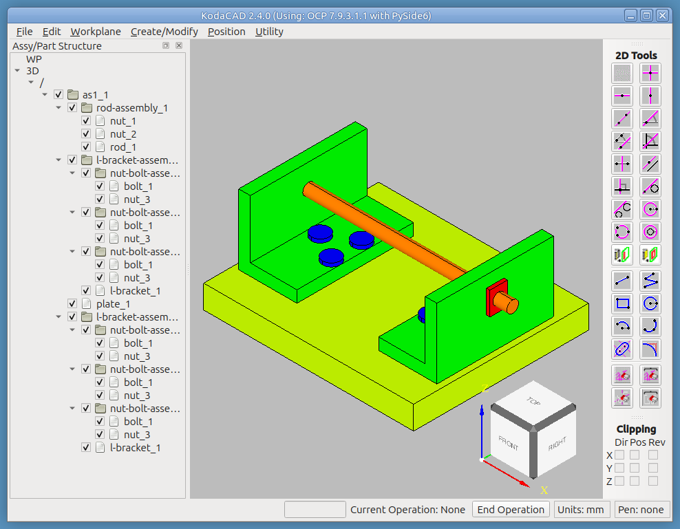

# KodaCAD 2

A from-scratch 3D CAD application
* Based on the original [KodaCAD](https://github.com/dblanding/kodacad)
* Built on OCP (Python bindings for OpenCascade's
    [OCCT](https://www.opencascade.com/)) -- see below for how this
    differs from other Python CAD libraries
* Patterned after HP's dynamic modeling lineage (ME-30 → SolidDesigner)
* Part creation workflow: workplane → sketch → extrude/revolve → modify 
* Intended to meet the basic requirements in a typical CAD workflow:
    * Start a new session or load a previous one (saved as a `.kcad`
      file: the STEP model plus your workplanes)
    * Import components in STEP format
    * Position them within an assembly structure
    * Create simple mounting plates & brackets
    * Modify parts directly, even ones you didn't build: remove
      features (**Defeaturing**) and push or pull faces (**Move Face**)
      with a live preview
    * Select, recolor, move and delete whole groups of parts with a box
    * Animate a mechanism (Geneva drive, four-bar linkage) with a
      slider and trace the path of a point
    * Save session as `.kcad`, or export the 3D model as plain STEP

Designed for users who want to assemble, modify, and create
3D mechanical parts and assemblies using a scriptable, open-source
toolchain -- with no commercial dependencies and no Conda environment.



## Dynamic modeling: change the part, not the history

A STEP file arrives with no feature tree. KodaCAD lets you edit it
directly, the way the HP/CoCreate lineage did:

* **Move Face** -- pick a face (or a box of faces), type a distance, and
  watch a live ghost of the result before you commit. A positive
  distance adds material (thickens a wall, narrows a slot); a negative
  one removes it (opens a hole up for a clearance fit). Faces that must
  move with the one you picked show in yellow, and heavy green or
  magenta lines mark exactly what changes.
* **Defeaturing** -- remove a hole, a pocket, a blend or a whole
  isolated feature, and the surrounding faces heal over the gap.
* **They work together.** When OpenCascade cannot build an offset, Move
  Face marks the faces that stand in its way in red and tells you what
  to remove first; Defeaturing takes them out, and the move goes
  through.

Try it on a real bracket in the
[Moving Faces tutorial](tutorials/move-face/README.md), and see
[Defeaturing a Part](tutorials/defeaturing/README.md) for the other half.

## What makes KodaCAD different

Most Python CAD libraries (build123d, CadQuery) represent assemblies as
**copies** of shapes organized in a Python object tree. This means
modifying one instance of a repeated part only affects that copy.

KodaCAD uses OCCT's **XDE document model** directly. In XDE, repeated
parts are stored once as a *prototype shape* and placed multiple times
as *instances* (references with location transforms). Modifying the
prototype automatically updates all placements -- exactly the behavior
you expect from professional CAD software like Creo or CoCreate.

**Example:** the `as1-oc-214.stp` test assembly has two L-bracket
assemblies, each containing the same L-bracket part. Applying a fillet
to one L-bracket updates both simultaneously, because they share the
same XDE root label.

---

## Who is it for

- Python programmers who want to work with real STEP assemblies
- Users coming from CoCreate / Creo who want familiar assembly workflow
- Developers who want to understand OCCT's XDE document architecture
- Anyone who needs to load, modify, and save STEP files with full
  assembly structure preserved

---

## Installation

KodaCAD uses [uv](https://github.com/astral-sh/uv) for dependency
management. No Conda required.


* [Install uv](https://docs.astral.sh/uv/getting-started/installation) if you don't have it

* Clone this repo
```
git clone https://github.com/dblanding/kodacad2
cd kodacad2
```

* Run directly -- uv handles all dependencies automatically
`uv run kodacad.py`


Dependencies (managed automatically by uv):
- `ocp` -- OCCT Python bindings (replaces PythonOCC)
- `pyside6` -- Qt6 Python bindings (replaces PyQt5)
- `build123d` -- used for geometry utilities

---

## How to use it

### Loading a STEP file

### Saving and loading

KodaCAD's native session file is a **`.kcad`** file. It is an ordinary
zip archive holding two things side by side, in the spirit of NumPy's
`.npz`:

```
mypart.kcad
  mypart.stp        the 3D model -- a standard STEP file
  workplanes.json   the workplanes, plain text
```

The STEP half carries everything a STEP file can: the assembly
structure, part names, colors, shared instances. The JSON half carries
what STEP has no place for: each workplane's position in 3D, its
sketched profile geometry (lines, circles, arcs), its construction
geometry, which workplanes are hidden, and which one was active. The
file is plain data -- nothing in it is executed when it loads -- and
because it is a zip, you can always open it with any archive tool and
pull out the `.stp` by hand.

**File → Save Session**
Writes a `.kcad` file holding the model *and* your workplanes. The file
is written to a temporary name and swapped into place only when
complete, so a failed save never damages an existing file.

**File → Load Session**
Opens a `.kcad` file -- or any plain `.stp` / `.step` file with
assembly structure. *Replaces the entire 3D document* -- whatever was
open before is gone. The loaded file's own content becomes the session,
with no wrapping or nesting involved.

What happens to workplanes depends on the file. A `.kcad` file brings
its own workplanes and replaces the ones on screen. A plain STEP file
has no workplanes to bring, so it **leaves your current workplanes
alone** -- handy for loading a part or assembly and sketching on it
with the workplanes you already have set up.

**File → Export STEP**
Writes the 3D model alone, as a plain STEP file, for opening in other
CAD applications or sharing with people who don't use KodaCAD. No
workplanes are included.

**File → Import STEP**
*Adds* a STEP file as a new component under the current `/`, alongside
whatever's already open, ready to be positioned and dragged into an
assembly. This is the one operation that nests a file's content under
an existing root, so it's the one that needs to guard against a saved
session's own `/` wrapper getting nested under the current one --
which it does automatically (see below).

#### What a session does *not* save

- **Undo/Redo history.** Loading starts you with a clean history.
- **Display-only face colors** (Color Faces...), which are an
  illustration aid, not part of the model.
- **A workplane's link to the face it was placed on.** The workplane
  keeps its position in space; it just no longer remembers which face
  it came from.

#### Undo and Redo apply to the 3D model only

Undo (Ctrl+Z) and Redo (Ctrl+Y) step through changes to the **3D
model** -- extrudes, pulls, fillets, shells, positioning, renaming and
so on. **Workplanes and their sketch geometry are not part of that
history.** Drawing a line, deleting an element, or repositioning a
workplane cannot be undone with Ctrl+Z, and undoing a 3D operation
will not rewind your sketches. Workplanes are your construction
scaffolding rather than the model itself, and they live outside the
document that Undo/Redo manages.

In practice this means: Undo is safe to use freely on the model without
disturbing your sketches, but a workplane edit is final until you make
the opposite edit yourself. Since a workplane's state is only stored
when you save, **Save Session before experimenting** with sketch work
you might want back -- the `.kcad` file is your safety net for
workplanes.

#### Why repeated save/load/import cycles stay clean

Save strips any
redundant `/` wrapper before writing, so a saved file never contains
one to begin with. Load Session replaces the whole document rather
than nesting anything, so there's nothing for a wrapper to accumulate
into. Import STEP is the one path that adds content under an existing
root, so it explicitly unwraps any `/`-named root in the file being
imported before adding its children -- composing locations through any
already-nested legacy wrapper levels in one pass, so even an older
file saved before this existed unwraps completely on import.

**Note on the tree's own `/` label:** the tree view always shows a `/`
under the `3D` header, whether or not anything is loaded -- that's
just the tree's own organizing scaffolding, not part of any document.
The document's actual root assembly label is *also* named `/` by
convention (visible in the tree as its child), which is why a
freshly-built, never-saved session can show what looks like `/` nested
under `/` -- two different things that happen to share a name, not an
accumulation bug.

### Assembly tree

The tree on the left shows the assembly hierarchy:
```
WP              ← workplanes (2D construction geometry)
  wp1
3D
  /             ← root of 3D assembly
    as1         ← loaded assembly
      rod-assembly_1
      l-bracket-assembly_1
        ...
    button      ← newly created part (ready to drag)
```

- **Checkbox** — show/hide part or assembly. Parent checkbox
  propagates to all children.
- **Left-click** — select item (Ctrl+click / Shift+click select several)
- **Right-click** — context menu: Item Info, Set Active, Rename,
  Create New Assembly, Create Empty Part, Create Shared Instance,
  Copy Part, Set Transparent, Set Opaque, Set Color..., Take Color as
  Pen, Paint with Pen Color, Color Faces (display only)..., Delete.
  Set Color, Paint with Pen Color and Delete act on **every selected
  part** when you right-click one of several selected rows.

### Working on groups of parts

The tree and the viewport select together, in both directions.

1. With no operation active, **drag a box** in the viewport (top to
   bottom is *window* mode: parts entirely inside the box; bottom to
   top is *crossing*: parts the box touches). Every part picked is
   highlighted in the tree, and the assemblies that hold them open up.
   Selecting several rows in the tree (Ctrl/Shift+click) likewise
   highlights all of them in the viewport.
2. **Move them:** drag any one of the selected rows onto an assembly
   (create one first with *Create New Assembly*). All of them move, and
   keep their place in space. The target must be an assembly; dropping
   onto a plain part is refused. A new sub-assembly is also the way to
   hide or show a group with one checkbox.
3. **Color them:** right-click one of the selected rows ->
   *Set Color...*.
4. **Delete them:** right-click one of the selected rows -> *Delete*.
   One confirmation, one undo (Ctrl+Z brings the whole group back).
   Only the *instances* are removed. A part's underlying prototype is
   removed too only when nothing else still uses it, so deleting one
   instance of a shared pair never damages the other. Workplanes and
   the top-level root in a selection are left alone.

### The pen: copy a color from one part to another

Matching an existing color by eye in the color picker is slow. Instead,
right-click a part -> **Take Color as Pen**. The status bar (lower
right) shows a swatch of the color and its hex value. Then right-click
any other part (or one of a group of selected parts) -> **Paint with
Pen Color**. The color is written into the document like *Set Color*,
so it is saved and survives a reload. The pen itself is not saved: it
is empty at the start of each session.

### Units

**Utility -> set Units** switches between inches, millimeters, feet and
meters (the status bar shows the current choice). Everything is held in
millimeters internally; typed distances, measurements and the Move Face
distance are converted. Pick feet or meters for large models; the
workplane label stays a sensible size at any scale.

### Animate Mechanism

**Utility -> Animate Mechanism...** moves the parts of an assembly with
a slider so you can see how a mechanism works, stop it in any pose
(then project faces onto a workplane to get a snapshot) and **Trace**
the path of a point. The motion is defined by a short Python file you
choose and can edit; `mechanisms/` has a 4-slot Geneva drive and a
pin-jointed four-bar. It is display only: the model, tree and undo
history are untouched, and *Done* puts every part back. How to write a
mechanism file: [docs/MECHANISMS.md](docs/MECHANISMS.md).

### If KodaCAD crashes

A crash closes the terminal along with the program, so KodaCAD also
writes crash information to **`kodacad-crash.log`** next to
`kodacad.py` (a start-up line each run; the last block before the next
start-up line is the crash). If you report a crash, send that file.
It is ignored by git and can be deleted at any time.

---

## Tutorials

Full, step-by-step walkthroughs live under [`tutorials/`](tutorials/) --
each one doubles as a regression test, with every step annotated with
what it exercises in KodaCAD's own code.

- **[The OCC Bottle](tutorials/occ-bottle/README.md)** -- builds the
  classic OpenCascade tutorial bottle entirely from scratch: sketching,
  Extrude, Fillet, Mill/Pull, Shell, and Undo/Redo, all on a single
  part.
- **[Assembly Structure with `as1-oc-214.stp`](tutorials/as1-oc-214/README.md)** --
  loading a pre-built, multi-part assembly two different ways, the XDE
  hierarchy viewer, and fillet propagation across a pre-existing
  shared instance.
- **[Build Assembly `as1` from a Kit of Parts](tutorials/build-as1-oc-214/README.md)** --
  the reverse of the tutorial above: starting from `as1-oc-214`'s five
  loose, un-positioned prototype parts and rebuilding the real
  assembly from scratch, exercising nearly every Position dialog
  method along the way.
- **[Building Quaoar's Chassis](tutorials/chassis/README.md)** --
  building a wheel-and-axle-in-a-chassis assembly from nothing:
  sibling-assembly creation, reparenting, shared instances (both a
  part and an assembly), the Position dialog's full surface, and
  Undo/Redo across a long, mixed operation history.
- **[Organizing an Assembly](tutorials/lathe/README.md)** --
  organizing a flat file in which all parts are a direct child of
  the root (often with cryptic names), into a hierarchical structure
  of functional subassemblies, making it easier to navigate. 
- **[Sketching a Jack-o'-Lantern](tutorials/jack/README.md)** --
  a full workout of the 2D sketch toolbar building a jack-o'-lantern
  face, then reusing the OCC Bottle's extrude-then-heavily-fillet
  technique to carve that same face into a pumpkin with a real,
  multi-profile Pull operation.
- **[Defeaturing a Part](tutorials/defeaturing/README.md)** --
  demonstrating the ability to remove holes and faces and to extend
  adjacent faces to heal the gap.
- **[Lofting a Hollow Part Through a Workplane Set](tutorials/lofting/README.md)** -- building a simple lofted part then working it over:
  subtracting one lofted part from another, a transverse hole, fillets,
  and finally defeaturing to take the fillets back off.
- **[Moving Faces](tutorials/move-face/README.md)** --
  pushing and pulling the faces of an imported L-bracket (`L-brkt.stp`)
  with a live preview: thickening a wall, opening up a slot, widening
  holes (box select and Ctrl+click to unpick), and what to do when
  OpenCascade cannot build an offset -- the red "suspect" faces, and
  Defeaturing to fix them.
  

## Tested workflows

### Load / Modify / Save
1. Load `as1-oc-214.stp`
2. Set `l-bracket_1` as active part
3. Apply fillet -- both L-brackets update simultaneously
4. Rename a bolt -- all shared instances update
5. Save session
6. Reload -- modifications preserved

### Create and place a new part
1. Load `as1-oc-214.stp`
2. Place workplane on top face of right L-bracket
3. Create a new part
    * RMB click on '/' iin tree; select "Create Empty Part"; name "button"
    * Draw 5mm circle on workplane
    * **Creare/Modify -> Pull**; Distance: 3mm
4. Button appears under `/` alongside `as1`
5. Drag button to `l-bracket-assembly_2`
6. Button appears in BOTH L-bracket assemblies (shared instance)
7. Save and verify in CAD Assistant -- color and name preserved

---

## File structure

```
kodacad2/
  kodacad.py          main entry point
  mainwindow.py       MainWindow, TreeView
  docmodel.py         XDE document model (core -- read this first)
  workplane.py        2D workplane geometry
  wp_io.py            .kcad session container + workplane save/restore
  m2d.py              2D sketch toolbar
  koda_viewport.py    OCP 3D viewport (AIS_ViewController)
  stepanalyzer.py     STEP structure analysis utility
  face_offset.py      Move Face geometry (per-face offset, no GUI)
  face_offset_server.py  persistent worker that computes the live preview
  face_offset_worker.py  one-shot worker used by Apply
  offset_preview.py   Qt client for the preview worker
  mechanism_dialog.py Animate Mechanism dialog (slider, Trace)
  trace_math.py       straight-section finder for Trace (plain Python)
  mechanisms/         mechanism files (Geneva drive, four-bar) + STEP models
  rpnCalculator.py    RPN calculator widget
  version.py          version string
  OCCUtils/           OCC geometry utilities (ported from PythonOCC)
  icons/              toolbar icons
  step/               sample STEP files
  docs/
    DEVELOPMENT_LOG.md  session-by-session development history
    MECHANISMS.md       how Animate Mechanism works; writing a mechanism file
    TODO.md             broken items + future ideas
  tutorials/
    occ-bottle/         build the OCC bottle from scratch
    as1-oc-214/         load and explore a pre-built assembly
    build-as1-oc-214/   rebuild that same assembly from loose parts
    chassis/            build an assembly from scratch (Quaoar's chassis)
    lathe/              organizing and navigating a large assembly
    jack/               sketch a jack-o'-lantern face, then carve a pumpkin
    defeaturing/        remove holes and features, heal the gap
    lofting/            loft through a workplane set, then work it over
    move-face/          push/pull faces of an L-bracket, with live preview
  pyproject.toml      uv project file
```

---

## Key concepts for developers

**docmodel.py is the heart of KodaCAD.** It wraps OCCT's XDE
(`XCAFDoc_DocumentTool`, `XCAFDoc_ShapeTool`, `XCAFDoc_ColorTool`) and
provides `parse_doc()` which builds `part_dict` and `label_dict` from
the live document. Everything else in the application reads from these
two dicts.

**The XDE label hierarchy:**
```
0:1:1:1   as1 (assembly)       <- GetFreeShapes returns this
0:1:1:2   rod-assembly          <- prototype shapes at root
0:1:1:3   nut
...
0:1:1:1:1  rod-assembly_1  => 0:1:1:2   <- component (instance)
0:1:1:1:2  l-bracket-assembly_1 => 0:1:1:5
```

**OCP vs PythonOCC:** Static methods get `_s` suffix in OCP.
`GetApplication()` → `GetApplication_s()`. See `docs/DEVELOPMENT_LOG.md`
for the complete list of API changes.

**Mouse picking has two separate pipelines** -- native OCCT 3D
selection and the 2D sketch engine's own pixel-to-workplane math --
that converge on one callback dispatcher. See
[`docs/PICKING_ARCHITECTURE.md`](docs/PICKING_ARCHITECTURE.md) for
the full picture, including a trap worth knowing about before editing
selection-mode code.
