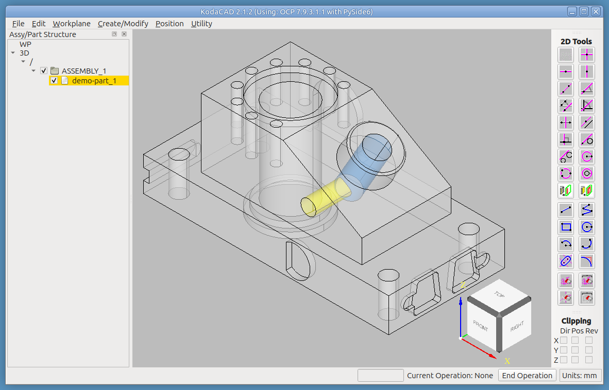
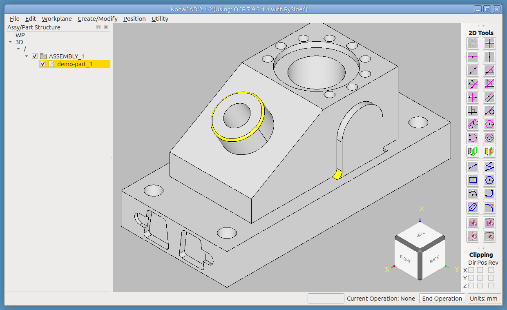
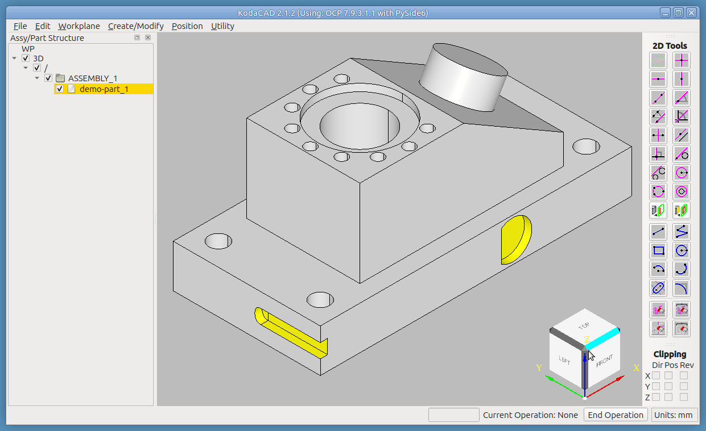
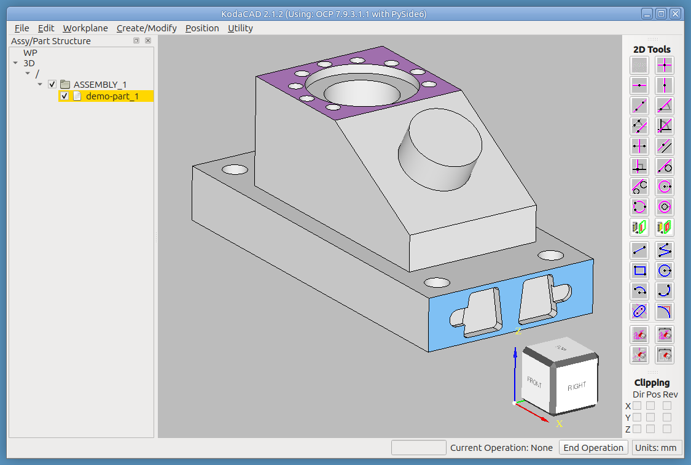
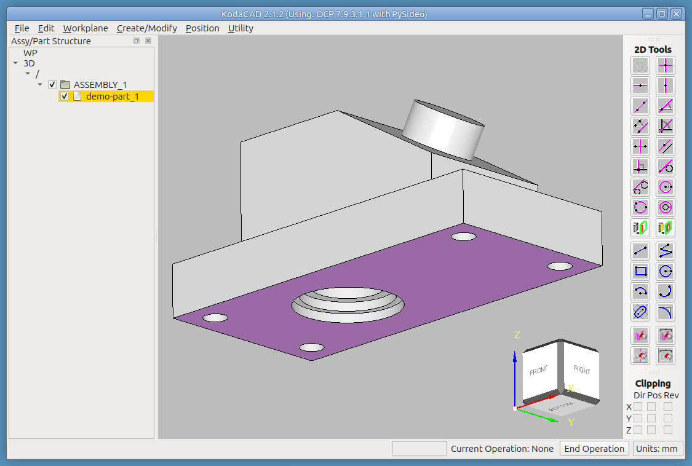

# Tutorial: Defeaturing a Part (`ANC101.stp`)

**Defeaturing** removes a feature -- a hole, a pocket, a slot, a fillet --
from a part that already exists, and heals the surrounding surfaces as if
the feature had never been there. It is the tool to reach for when you
import someone else's part and want to simplify it for analysis or
machining, or when you want to take a blend back off a part you made
yourself.

KodaCAD is built on the OpenCASCADE (OCCT) kernel, which has an official
algorithm for this, `BRepAlgoAPI_Defeaturing`. You hand it a solid and a
list of the faces that make up the unwanted feature (the cylindrical wall
of a hole, the rounded face of a fillet, ...). It removes those faces and
**extends the neighboring faces** until they close the gap. That is more
than deleting geometry: deleting faces would leave a hole in the shape,
whereas extending and re-stitching the surrounding faces leaves a valid,
closed solid.

KodaCAD's **Create/Modify -> Defeaturing...** dialog gives you three ways
to say *which* faces make up the feature. This tutorial walks through all
three on one demonstration part.

## What you'll need

A fresh (empty) KodaCAD session. `ANC101.stp`, in this folder, is the
demonstration part.

## What this exercises

**Create/Modify -> Defeaturing...** with each of its three methods --
**Remove Hole**, **Manual (pick every face)** and **Auto (pick capping
face(s))** -- plus the dialog's Apply/Done behavior, Undo/Redo across
several defeaturing operations, and the limits of Auto detection. The
last step doubles as a regression test: if its result differs from what
is written here, something has changed.

---

## Step 1 -- Load the part and open the dialog

**File -> Import STEP**, and choose `ANC101.stp`.

Right-click the part in the tree (it appears as `demo-part_1`) and choose
**Set Active**. Defeaturing always works on the active part, and the part
stays active for the rest of the tutorial.

Open **Create/Modify -> Defeaturing...**. The dialog has:

* **Method** -- how you identify the feature's faces (the subject of
  Steps 2-6).
* **Apply** -- performs one removal using the faces currently picked.
* **Done** -- ends the Defeaturing session and closes the dialog.

The dialog is non-modal: it stays open across several Apply presses, so
you can remove feature after feature without reopening it, and you can
rotate the view between picks. **Each Apply is its own undo step.**

*Exercises: STEP import; Set Active; the Defeaturing dialog.*

## Step 2 -- Remove Hole

We will remove two holes, highlighted yellow and blue in the view above.
The view is drawn transparent so you can see the holes inside the part.
The yellow hole is a *through* hole between the front face and the blue
hole. The blue hole is a *blind* hole: it ends inside the part instead of
coming out the other side.

* In the dialog, choose **Method: Remove Hole**.
* Pick the yellow hole (click on its cylindrical wall) and click
  **Apply**.
* Now pick the blue hole and click **Apply**.

Both holes are removed, even though the second one is blind. Remove Hole
handles that automatically:

1. It checks that the face you picked is **cylindrical**. If it is not,
   the dialog tells you to pick a cylindrical face.
2. A hole's wall is often split into several patches (for example where
   another bore crosses it). So it collects **every cylindrical face with
   the same radius and the same axis** as the one you picked.
3. For a blind hole, it also finds the **cap**: a face bounded by a
   single edge that touches one of those walls, which is the bottom of the
   hole.
4. It hands all of those faces to the defeaturing algorithm at once.

When you are finished, use **Edit -> Undo (Ctrl+Z)** twice to bring the
holes back, then **Edit -> Redo (Ctrl+Y)** twice to remove them again.
Leave the dialog open for the next step, or click **Done** and reopen it
when you need it.

*Exercises: Remove Hole; blind and through holes; Undo/Redo of
defeaturing.*

## Step 3 -- Remove individual blends (Manual, one face at a time)

Rotate the part to the view above. The two yellow features are each an
individual blend (a single rounded face). Once a blend is removed, the adjacent faces revert
to the sharp-cornered configuration they would have had without it.

* In the dialog, choose **Method: Manual (pick every face)**.
* Pick one of the two highlighted faces and click **Apply**.
* Pick the other one and click **Apply**.
* Click **Done**.
* Undo twice.

Now go through it again, but this time pick **both** faces first and click
**Apply** once. The result is the same, but it is now a single undo step.

*Exercises: Manual method; one face per Apply versus several; Done.*

## Step 4 -- Remove multi-face features (Manual, every face)

Rotate to the view above. The two yellow features are each made of
**several** faces: a long slot open at the end of the plate, and a
D-shaped pocket in the other side face. Reopen **Create/Modify ->
Defeaturing...** if you clicked Done.

* In the dialog, choose **Method: Manual (pick every face)**.
* Pick **every** face of one of the two features (the floor, every wall
  and any rounded end), then click **Apply**.
* Do the same for the other feature.
* Click **Done**.
* Undo twice, then Redo twice.

Manual is tedious, and unforgiving: if you skip a face of the feature, the
algorithm has nothing to say about it, and the result is either a feature
that is only partly removed or no change at all. Watch the dialog's
**"N face(s) selected"** count as you pick. If Apply reports that it was
**unable to remove the feature**, one or more of the faces needed is
missing from the selection.

*Exercises: Manual method with several faces per feature.*

## Step 5 -- Automatic detection of isolated features

Now we will do it the easy way. In an
[article on Analysis Situs](https://analysissitus.org/features/features_isolate-features.html),
Sergey Slyadnev describes an algorithm for detecting **isolated
features** in a part. Rather than picking every face of a feature, you
pick the face that **caps** it -- the flat face the feature was cut into
or built on -- and the algorithm works out the rest. KodaCAD uses the same
idea, written independently for KodaCAD.

Rotate to the view above. The blue face caps the two pocket features cut
into it. The purple face caps the ring of nine blind holes.

* In the dialog, choose **Method: Auto (pick capping face(s))**.
* Click the blue face and click **Apply**.
* Click the purple face and click **Apply**.
* Click **Done**.
* Undo twice, then Redo twice.

### How it works

A capping face has the feature's opening in it as a closed loop of edges
entirely **inside** the face (an *inner wire* -- compare the outline of a
hole in a plate). The algorithm:

1. Builds the **face-adjacency graph** of the whole part: two faces are
   adjacent if they share an edge.
2. Removes the picked (capping) face or faces from that graph. What is
   left falls apart into separate connected **islands**.
3. One island is just "the rest of the part," reached across the picked
   face's own **outer** boundary. Discard it, and any island that touches
   it.
4. Any other island that touches **every edge of one of the picked
   faces' inner wires** is a feature. Those faces are what get removed.

Notice what this means: **one Apply removes *every* feature capped by the
picked face(s).** Picking the blue face removes both pockets; picking the
purple face removes all nine holes. If you want
only one of several features, use Manual instead.

*Exercises: Auto method; features with several inner wires.*

## Step 6 -- Automatic detection between two capping faces

This demo removes the hole with several counterbores that runs from the
top (purple) face all the way through to the bottom (purple) face.

Why does this one need **two** picks? A feature open at only **one** end,
such as a blind hole or a boss, becomes its own island as soon as its one
capping face is removed from the graph (Step 5). A **through** feature is
open at both ends, so its wall also touches the *second* opening's
face. If that face is not picked it stays in the graph, still connected
to the rest of the part, so the wall never separates into its own island
and the algorithm (correctly) finds nothing. Picking **both** capping
faces breaks both connections at once.

* In the dialog, choose **Method: Auto (pick capping face(s))**.
* Click the purple top face, then rotate to the view above and click the
  purple bottom face. (Both should be selected: the dialog says
  "2 face(s) selected".)
* Click **Apply**.
* Click **Done**.
* Undo, then Redo.

*Exercises: Auto with two capping faces; through-features.*

## Step 7 -- When Auto can't see a feature

Auto only finds a feature whose opening is a **closed loop inside** a
picked face. A feature whose opening runs into the *edge* of a face -- a
notch, or a slot open at the end like the one from Step 4 -- has no such
loop in that face: its opening is part of the face's **outer** boundary.
Auto has nothing to grow from, so it leaves that feature alone.

To see this, undo back to the original part, rotate to the view from
Step 4, and choose **Method: Auto**. Pick the face(s) that the slot and
the D-shaped pocket open into, and click **Apply**. Only the D-shaped
pocket is removed (3 faces: the part goes from 86 faces to 83); the
open-ended slot is still there. A loop of edges fully inside a face is
what Auto needs, and the pocket has one while the slot does not.

For features like the slot, use **Manual** and pick every face of the
feature (Step 4).

*Exercises: the limits of Auto detection.*

---

## Notes for whoever runs this next

- **The dialog says "Feature removed." only if something changed.** The
  OCCT algorithm itself can report success while removing nothing, so
  KodaCAD compares face counts before and after and reports "Unable to
  remove this feature" if the part did not change. The terminal also
  prints how many of the requested faces the algorithm actually deleted.
- **Color Faces helps with illustrations and planning.** The yellow, blue
  and purple faces in the screenshots were made with RMB on the part ->
  **Color Faces (display only)...**. The colors are display-only: they are
  not saved in the file, and they clear when the part is modified.
  Coloring the faces you intend to pick, before you pick, is also a good
  way to check which faces a feature really consists of.
- **Fillets next to a Shelled inner surface may refuse to come off.**
  Defeaturing silently skips blends adjacent to the inner surface made by
  **Create/Modify -> Shell**. The same blends *can* be removed if the
  hollow part is made as an outer body minus an inner body with
  **Boolean -> Subtract**. See the
  [Lofting tutorial](../lofting/README.md), Steps 6 and 10.
- **Removing blends as a group can leave seam lines**; clearing them with
  Manual is described in the same Lofting tutorial step.
- If any menu label, dialog control name, or message has drifted from
  what is written here, fix it in this document directly -- catching that
  drift is exactly what this tutorial is for.
