# Tutorial: Lofting a Hollow Part Through a Workplane Set (`loft-demo.stp`)

In a typical workflow, a profile on a workplane is **pulled** so that it
sweeps through 3D space, adding material to a part or removing it. In
**lofting**, a stationary **Workplane Set** -- several workplanes, each
holding a profile -- defines a smooth surface that passes through all of
the profiles, like the hull of a boat or the skin of an airplane
fuselage. Other typical uses are an airplane wing or a turbine blade.

This tutorial builds a simple lofted vase and then works it over: a
hollow wall made directly by the loft (outer and inner profiles on
each workplane), a
transverse hole, fillets, and finally Defeaturing to take the fillets
back off. It doubles as a regression test for the Workplane Set and Loft tools.

## What you'll need

A fresh (empty) KodaCAD session. `loft-demo.stp`, in this folder, is the
finished part (fillets included) for comparison, or for trying the
Defeaturing and Other Tests steps without rebuilding the part first.

## What this exercises

Workplane creation, construction circles, **Workplane -> Set...**,
drawing profiles on the individual workplanes of a set, Create Empty
Part, **Loft** with outer and inner profiles (a hollow section), Save Session
and the Undo/Redo caveat that goes with it, **Workplane -> By 3 points**,
**Pull** (Remove Material, Linear), Fillet, **Defeaturing** (including
what happens to the surface seam), and afterwards Create Shared Instance
and Copy Part on a lofted part.

---

## Step 1 -- Create the reference workplane

We start with a *Reference workplane*, which *anchors* the new workplane
set. It is not itself a member of the set -- it only defines where the
set goes.

**Workplane -> At Origin, XY Plane**

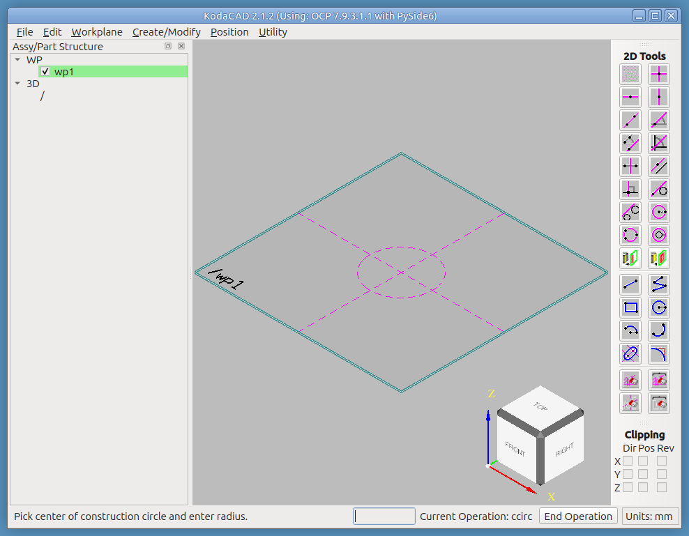

Once wp1 exists, draw a construction circle on it with its center at the
origin and radius = 30. We don't need it yet, but we will use it in Step
8 to place another workplane.

*Exercises: workplane creation; construction circle.*

## Step 2 -- Create the Workplane Set

**Workplane -> Set...**

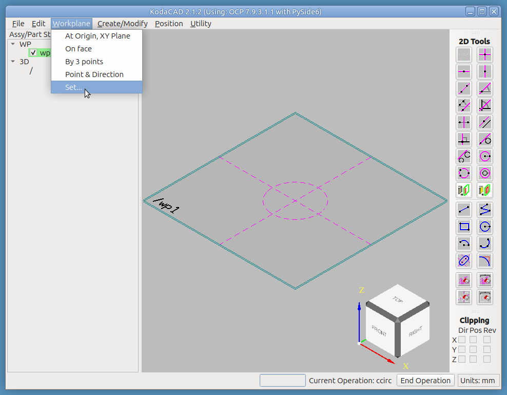

The dialog asks for:

1. **Number of workplanes (N)** -- how many parallel workplanes the set
   will contain.
2. **Spacing along +W** -- the uniform spacing between workplanes,
   starting with the space between the Reference workplane and the
   first workplane of the set.

For this tutorial use **N = 5** and **Spacing = 20** mm.

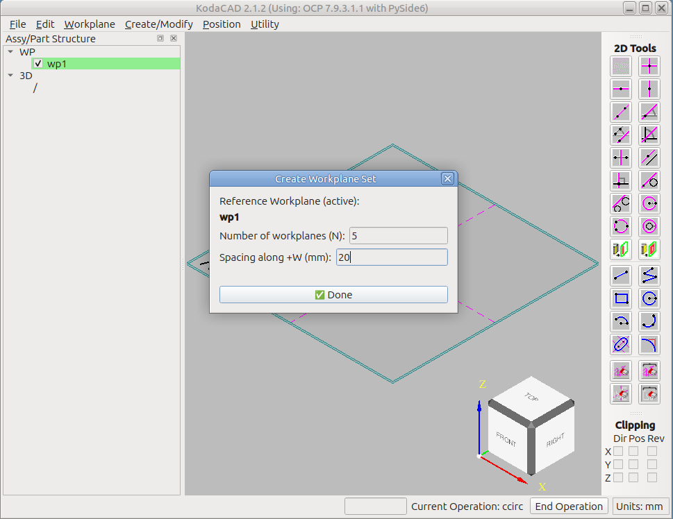

Click **Done**. This creates `s1`, the set containing `wp2` through
`wp6`. They appear both in the viewport and in the tree. The last one
created is **active**, shown with green highlighting in the tree. Only
the active workplane can be drawn on, so keep an eye on this in the next
step.

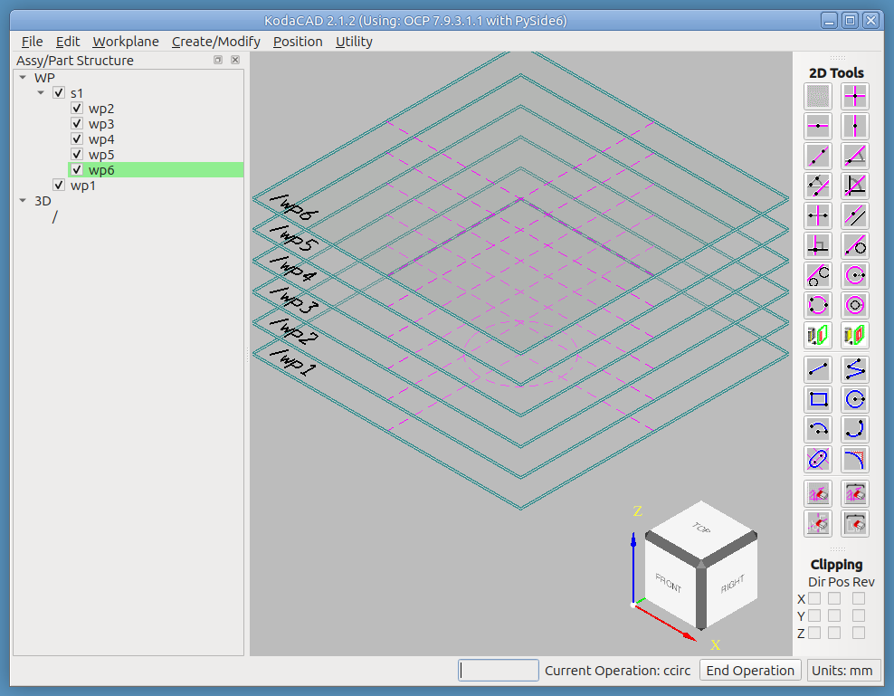

*Exercises: Workplane Set creation; the active workplane.*

(For workplanes that are not evenly spaced and parallel, see
[Alternative -- build the set from workplanes you already have](#alternative----build-the-set-from-workplanes-you-already-have)
at the end of this tutorial.)

## Step 3 -- Draw the profiles

Each workplane of `s1` gets **two** concentric circles: the **outer**
profile and an **inner** profile, which the loft turns into a hole. The
wall will be 5 mm thick. To draw on a workplane, first make it active
(RMB the workplane in the tree, then **Set Active**). Each circle is
centered on the workplane's origin (where the horizontal and vertical
construction lines cross). The radii are:

| Workplane | wp2 | wp3 | wp4 | wp5 | wp6 |
|-----------|-----|-----|-----|-----|-----|
| Outer radius (mm) | 20 | 25 | 30 | 25 | 20 |
| Inner radius (mm) | 15 | 20 | 25 | 20 | 15 |

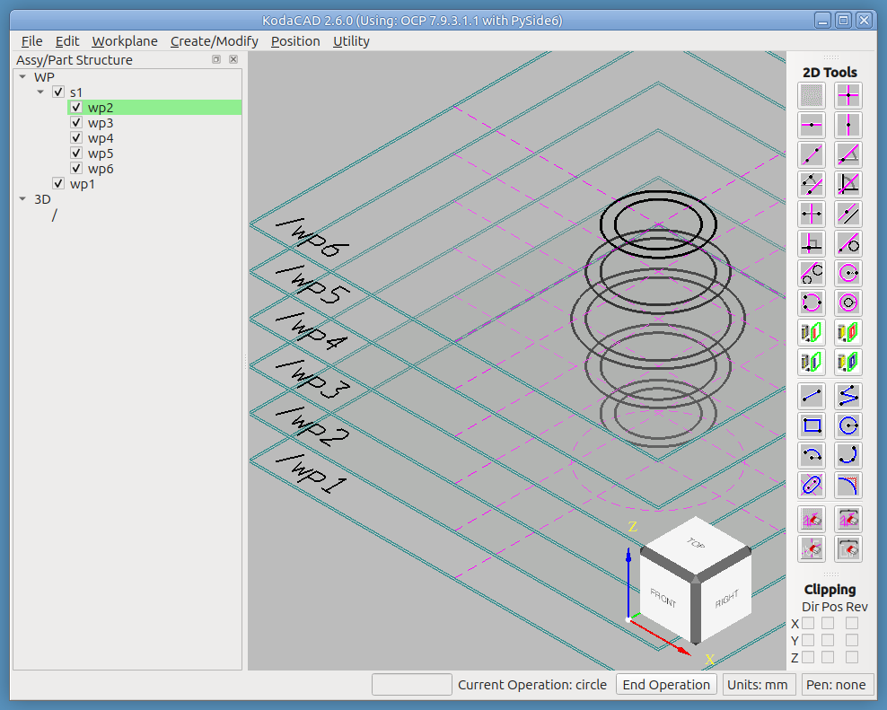

Every workplane must carry the **same number** of inner profiles (here,
one). KodaCAD tells outer from inner by containment: the loop that
encloses the others is the outer one.

*Exercises: switching the active workplane; circle profiles; outer and
inner profiles on one workplane.*

## Step 4 -- Loft the hollow part

Lofting needs an empty part to receive the result. RMB the **'/'** in
the tree and choose **Create Empty Part**. Name it `vase`. (The tree
shows it as `vase_1`, as usual for a part's occurrence name.) It is
highlighted in yellow, which means it is the **active part**.

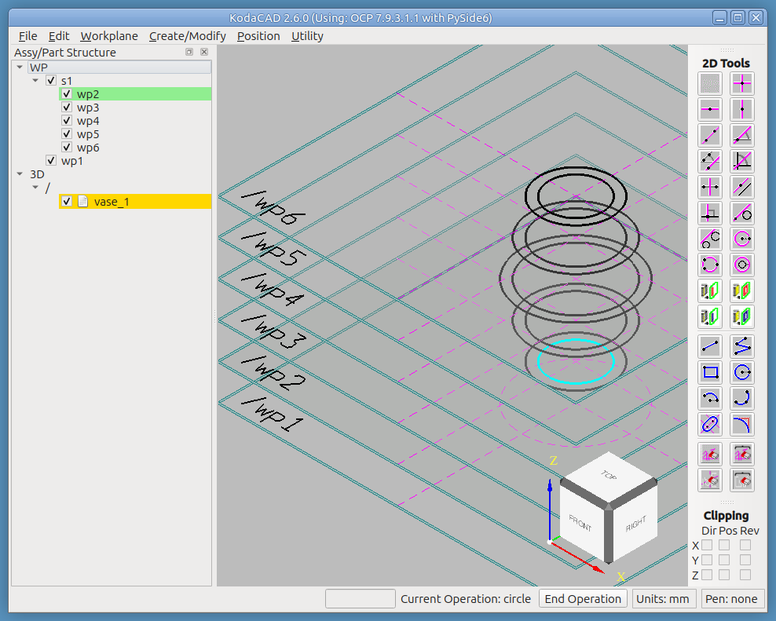

With an active part, and with a workplane of the set active, click
**Create/Modify -> Loft**. The loft passes a smooth surface through the
five outer profiles, then lofts the five inner profiles the same way
and cuts that inner shape out of the outer one. The result is a hollow
vase with a 5 mm wall, open at both ends. This operation proceeds pretty quickly, but for lofts that are slower, a Working box would appear displaying a **Cancel** button. (see "Booleans can't freeze KodaCAD" in the main README).

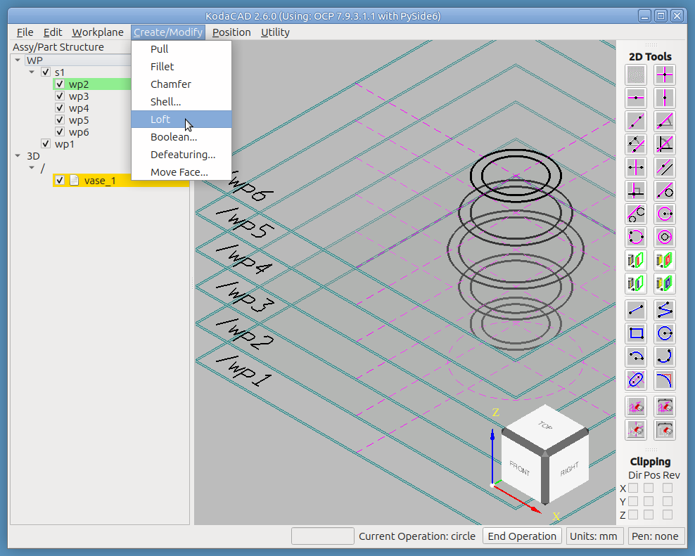

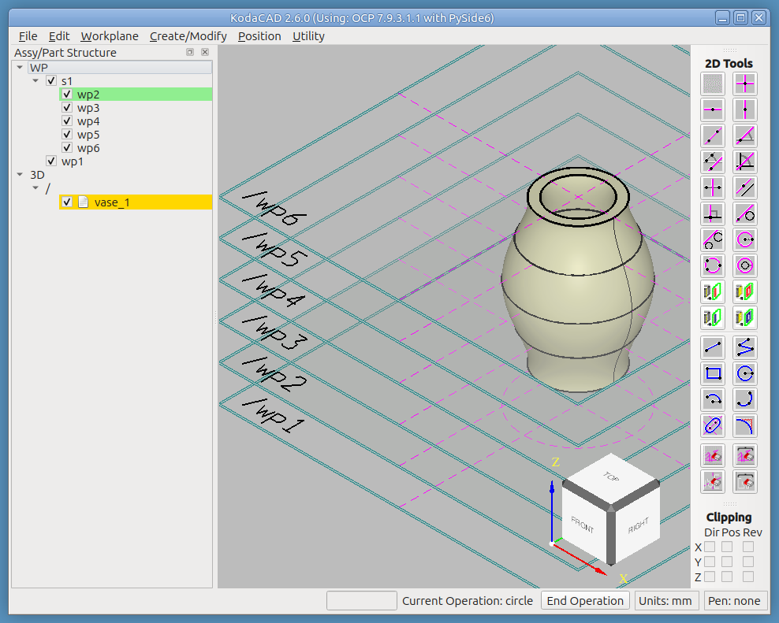

*Why not simply Shell a solid loft with a thickness of 5 mm?* Because
later we will want to remove or modify features such as fillets using
**Defeaturing**. In our testing, fillets and chamfers adjacent to a
*shelled* surface cannot be removed by Defeaturing -- the operation
reports success but leaves the feature in place -- whereas the same
fillets next to a *lofted* inner surface can. We don't know exactly why
Shell causes this, but lofting the inner surface avoids it.

*Exercises: Create Empty Part; Loft with outer and inner profiles
(workplane set identified by its active workplane).*

## Step 5 -- Save the session

Two things worth doing right now:

1. **File -> Save Session.** The `.kcad` file keeps the model *and* its
   workplanes and workplane sets (a plain STEP file would keep only the
   3D geometry and assembly hierarchy).
2. If you want to look back, this is also the time to check that the
   Undo steps that built the part are available. Undo/Redo history is
   **not** saved in the file, so it is gone after a reload.

**Warning:** if you click Undo all the way back to the very first
operation, this session is toast -- you will be back to an empty
session. Save first (item 1 above) before experimenting with that particular
stick of dynamite.

The good news is that every remaining step can be done just as well
starting from the reloaded session file.

*Exercises: Save Session; the Undo/Redo limits across a save/reload.*

## Step 6 -- Punch a transverse hole

Back in Step 1 we drew a construction circle on wp1 and said we would use
it. Now is the time. Make wp1 active, then click **Workplane -> By 3
points** and pick, in order:

1. the **center** of the construction circle -- the origin of the new
   workplane;
2. the **lower intersection** of the circle with the vertical
   construction line -- this sets the **+W** direction;
3. the **right-hand intersection** of the circle with the horizontal
   construction line -- this sets the **+U** direction.

On the new workplane, draw a circle profile of **radius 10 mm** at the
center of the lofted part. To find the center, project the top and bottom
faces of the part onto the workplane and construct the bisector between
them.

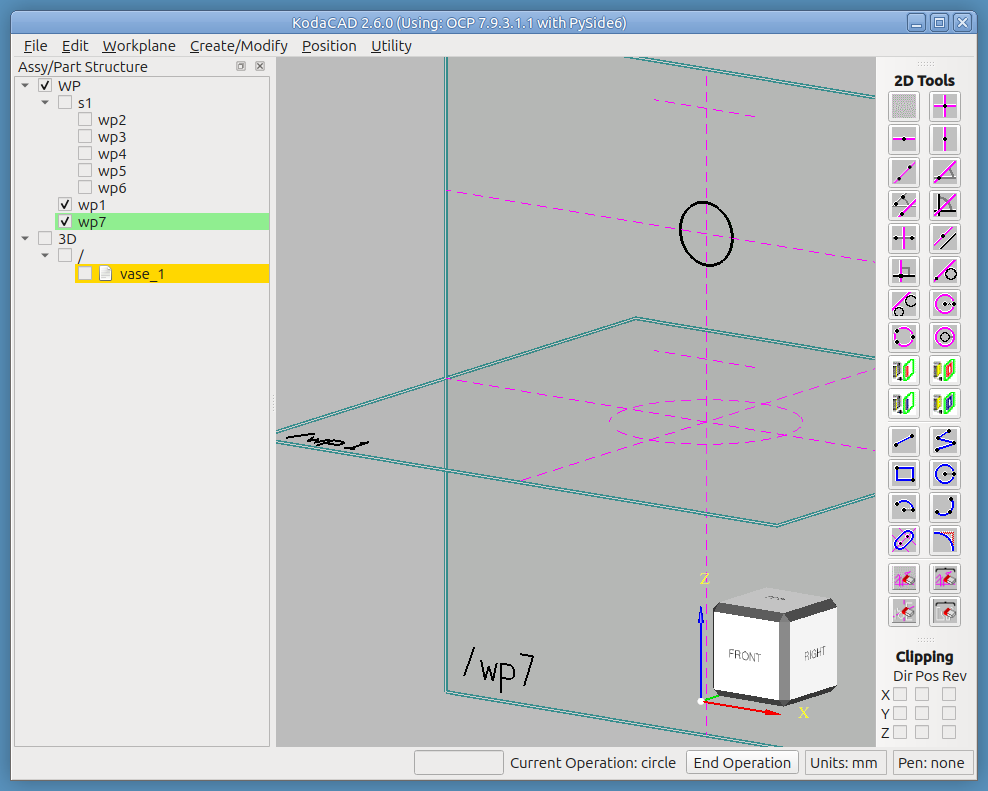

Now, with the new workplane and the lofted part both active, click
**Create/Modify -> Pull** and choose:

* **Operation:** Remove Material
* **Mode:** Linear
* **Direction:** +W
* **Distance:** 35

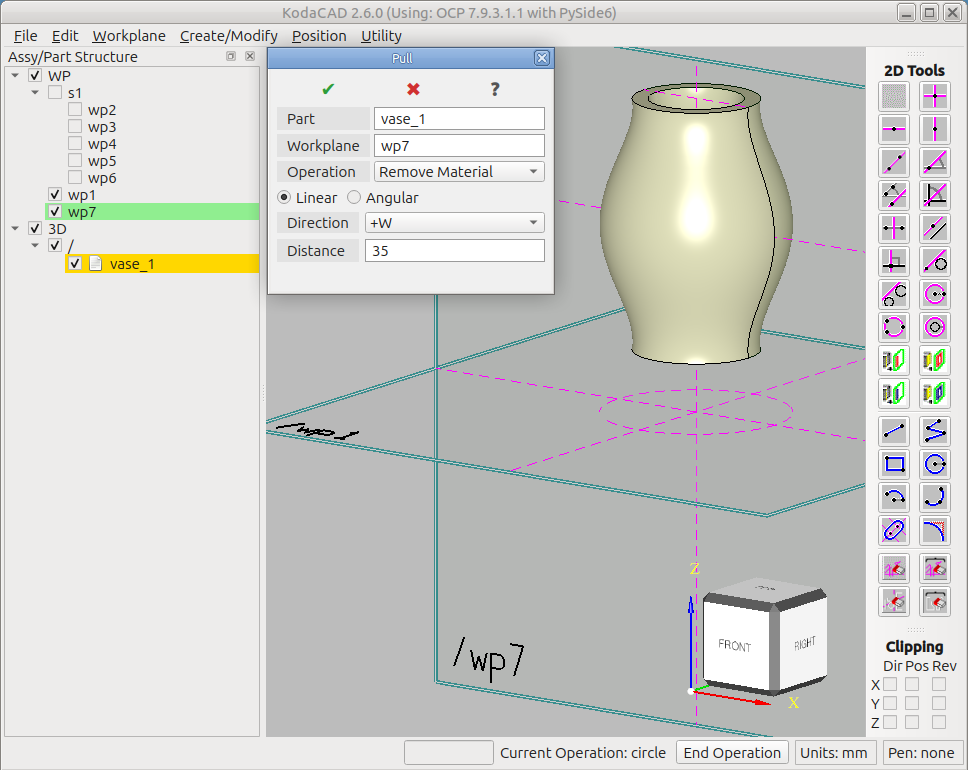

Click **✔** (Done). The hole goes through the front wall of the part, as the
section view below shows.

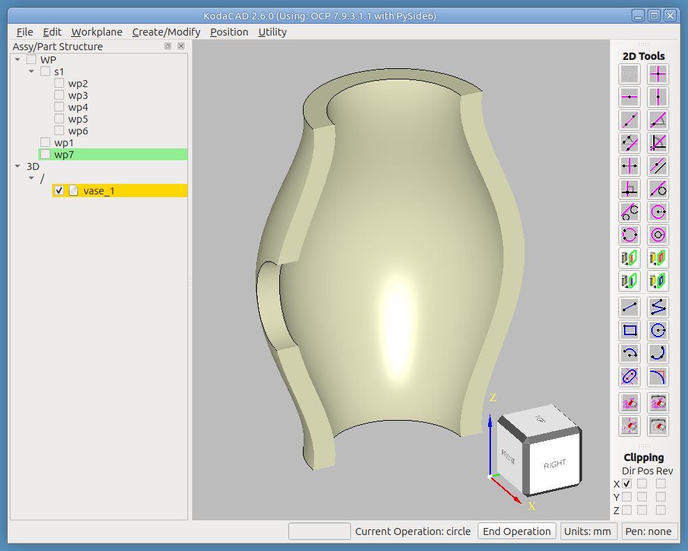

*Tip:* choose **Direction: Both** to cut through both walls at once. The
Distance is split equally between +W and -W, so a Distance
above 70 clears both walls.

*Exercises: Workplane -> By 3 points; projecting faces onto a workplane;
Pull, Remove Material, Linear, +W (and Both).*

## Step 7 -- Apply fillets

Apply fillets (or chamfers) to all the sharp edges of the part: the top,
the bottom, and both rims of the transverse hole. The wall is only 5 mm
thick, so choose a radius comfortably under that (1.5 mm, say).

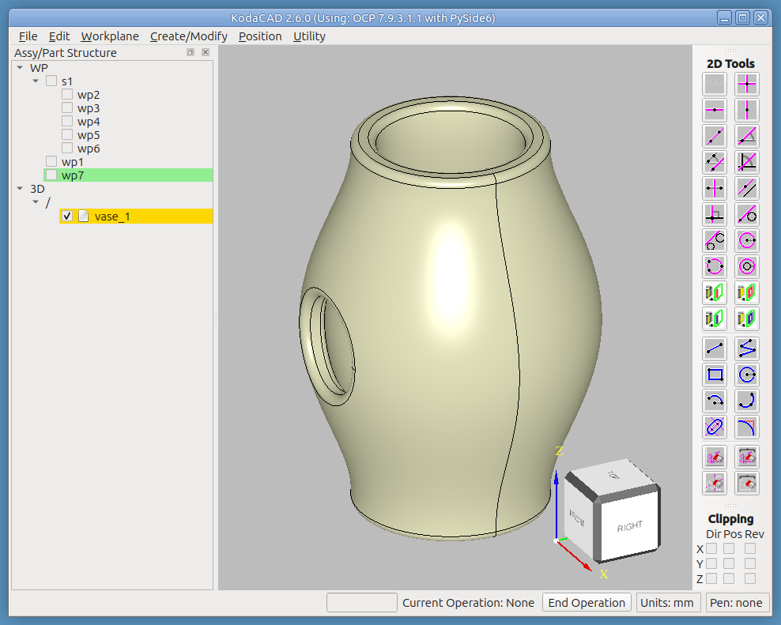

*Exercises: Fillet, including edges next to lofted (B-spline) surfaces.*

## Step 8 -- Test Defeaturing

Now check that the fillets can be taken back off. Open
**Create/Modify -> Defeaturing...**, choose **Manual (pick every face)**,
click the faces of one fillet, then click **✔** (Apply). Repeat for the others.

Two things to notice:

* All of the fillets should be removable, including those next to the
  *inner* lofted surface -- which is exactly why Step 4 lofts the
  inner surface instead of shelling.
* If you remove several fillets together as one group, "scar lines" can
  be left on the lofted face along the circle where each fillet met it.
  Removing the fillets one at a time does not leave them. If a seam does
  remain, pick the smaller of the two faces with the **Manual** method
  and click **✔** (Apply), and the seam is gone.

*Exercises: Defeaturing (Manual); fillets next to a lofted surface; seam
cleanup.*

## Step 9 -- Other tests

Repeat any of these on the finished lofted part:

* **Save Session**, then **Load Session**: names and color should
  survive.
* **Create Shared Instance** (RMB the part), move the instance, then
  modify the original (for example, cut the hole with Pull): both
  instances should update.
* **Copy Part** (RMB), move the copy with **Position**, then remove a
  fillet from the copy only: the original and its shared siblings should
  stay unchanged.

*Exercises: STEP round trip of lofted geometry; shared-instance redraw;
independent copies.*

---

## Alternative -- build the set from workplanes you already have

**Workplane -> Set...** (Step 2) makes evenly spaced, parallel
workplanes. Real shapes are rarely that regular: the deck of a bridge,
a fuselage, a hull. For those, make each workplane where you need it --
on a face, through three points, at an angle -- and gather them into a
set afterwards:

1. Create the workplanes **in the order the loft should pass through
   them** (the set keeps them in creation order).
2. In the tree, select all the workplanes you want included in the set. (Ctrl-click and Shift-click work in the standard way.)
3. In the tree, right-click one of them and choose **Make Workplane Set**. The status bar lists the members in loft order. A workplane that was already in
   another set is moved out of it.
4. Draw the profiles and loft exactly as in Steps 3-4: make a workplane
   of the set active and choose **Create/Modify -> Loft**.

The workplanes need not be parallel or evenly spaced, and the profiles
on them need not be the same size. Each workplane may carry an outer
profile and holes (the same number of holes on every workplane), which
is how Step 4 gets its hollow section. This is how the model of the [Linn Cove Viaduct](https://github.com/dblanding/Linn-Cove-Viaduct) deck was built: a workplane every few segments, each carrying the deck's cross-section.

*Exercises: Make Workplane Set; lofting through irregular workplanes.*

## Lofting onto an existing part

Step 4 lofts into an **empty** part. If the active part already
has material, the loft is **fused to it** instead. So to grow a shape
out of an existing part:

1. Put the first workplane of the set **on a face of the existing part**
   (**Workplane -> On face**), so the
   first profile sits on that face. Draw the profile there.
2. Make the remaining workplanes and draw their profiles; gather them
   into a set (either way above).
3. Make the existing part the **active part**, make one workplane of the
   set active, and choose **Create/Modify -> Loft**.

The lofted solid starts at the face and is fused into the part: no
second part to position, and no separate Boolean. For the
fuse to be clean, make the first profile coincide with, or lie inside,
the face it is on.

## Notes for whoever runs this next

- If any menu label, dialog control name, or message has drifted from
  what is written here, fix it in this document directly -- catching
  that drift is exactly what this tutorial is for.
- Fillet and chamfer radii in Step 7 are a suggestion, not a requirement;
  anything that fits within the 5 mm wall works.
- See the [OCC Bottle tutorial](../occ-bottle/README.md) for the Shell
  operation, which is the road not taken in Step 4.
- See the [Jack-o'-Lantern tutorial](../jack/README.md) for more of
  Pull and the 2D sketch toolbar.
