# Tutorial: Moving Faces (`L-brkt.stp`)

**Move Face** pushes or pulls one or more faces of a part by a distance you
type, and lets the rest of the part follow: the walls next to the face
stretch or shrink to meet it, holes get longer or shorter, and the part
stays a valid solid. It is the direct-modeling answer to "make this wall
2 mm thicker" or "open that hole up 0.35 mm for a clearance fit" when you
have a STEP file and no feature history to edit.

KodaCAD is built on the OpenCASCADE (OCCT) kernel. Move Face uses its
**offset** algorithm, `BRepOffset_MakeOffset`, with a separate offset
distance for each picked face. A positive distance moves the face
**outward**, along the solid's outward normal, so it **adds material**: a
boss grows, a slot or hole gets *narrower*. A negative distance **removes
material**: a wall gets thinner, a slot or hole gets *wider*.

Move Face shows you the answer *before* you commit. While you type, a
translucent ghost of the result is drawn over the part, together with
colored lines that mark what changes. Nothing is applied until you press
**Apply**.

## What you'll need

A fresh (empty) KodaCAD session. `L-brkt.stp`, in this folder, is the
demonstration part: a bracket from the Elegoo Tumbller robot, a flat base
with four holes and an upright with a long slot, six countersunk mounting
holes and a rounded top.

## What this exercises

**Create/Modify -> Move Face...**, with its live preview, picking and
unpicking faces (click, box select, Ctrl+click), the orange/yellow
selection colors, the volume read-out, and Undo. Step 4 also shows what to
do when OpenCascade cannot build an offset, using the red "suspect" faces
the dialog marks for you, and **Create/Modify -> Defeaturing...**.

## The colors

| Color | Meaning |
|-------|---------|
| **Orange** | A face you picked. |
| **Yellow** | A face that is **not** picked but moves too, because it meets a picked face tangentially (for example the round end of a slot, next to a flat wall). |
| **Red** | A *suspect* face: very narrow, or touching a very short edge. These can stop OpenCascade from offsetting anything on the part. Only shown when a preview fails (Step 4). |
| **Cyan, translucent** | The ghost: the whole result as it would look after Apply. |
| **Green lines** | Edges the move adds: new outline, and the short stretch an edge grows by. Used when the move **adds** material. |
| **Magenta lines** | The same, when the move **removes** material. |

The orange, yellow and red colors, and the ghost, are display only. They
are not saved in the file.

---

## Step 1 -- Load the part and open the dialog

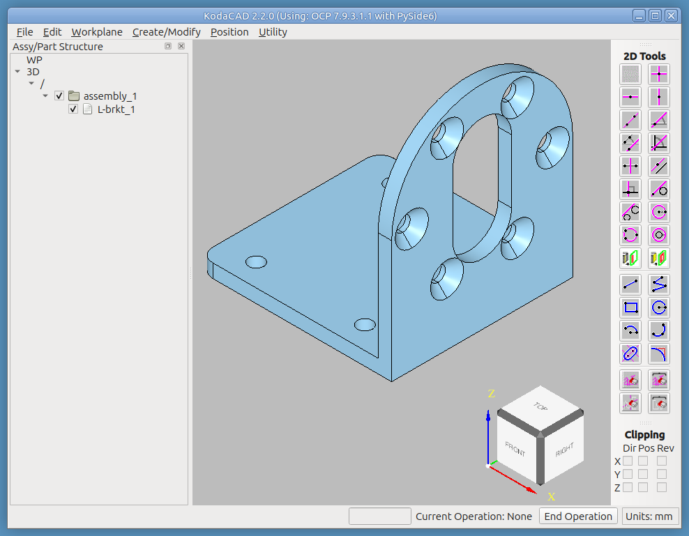

**File -> Import STEP**, and choose `L-brkt.stp`.

Right-click the part in the tree (it appears as `L-brkt_1`) and choose
**Set Active**. Like Defeaturing, Move Face always works on the active
part.

Open **Create/Modify -> Move Face...**. The dialog has:

* **Distance** -- how far to move, in the current units (mm here). Type a
  number, or use the up/down keys or the mouse wheel to step it. Positive
  adds material, negative removes it.
* **Live preview** -- draws the ghost and the colored lines as you type.
  Turn it off if a very large part makes it slow.
* **Apply** -- performs the move on the picked faces.
* **Clear Selection** -- unpicks everything.
* **Done** -- closes the dialog.

The dialog stays open across several Apply presses, and **each Apply is
its own undo step** (Ctrl+Z).

*Exercises: STEP import; Set Active; the Move Face dialog.*

## Step 2 -- Thicken the upright

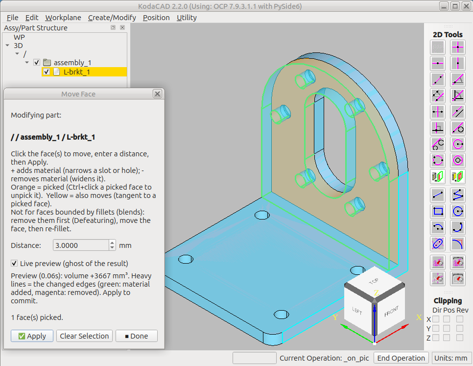

Rotate to the view above. We will make the upright thicker on the side
that faces the base.

* Click the large flat face of the upright on the base side. It turns
  **orange**.
* Type **3** in **Distance**.

Without pressing anything else, a ghost appears. The **green** lines show
where the new faces will be. Straight edges that run through the thickness
get only a short green stub, the 3 mm they grow by, not a line the whole
length of the part. The dialog reports the volume change before you commit:
**+3667 mm³**, which is the face area times 3.

Click **Apply**.

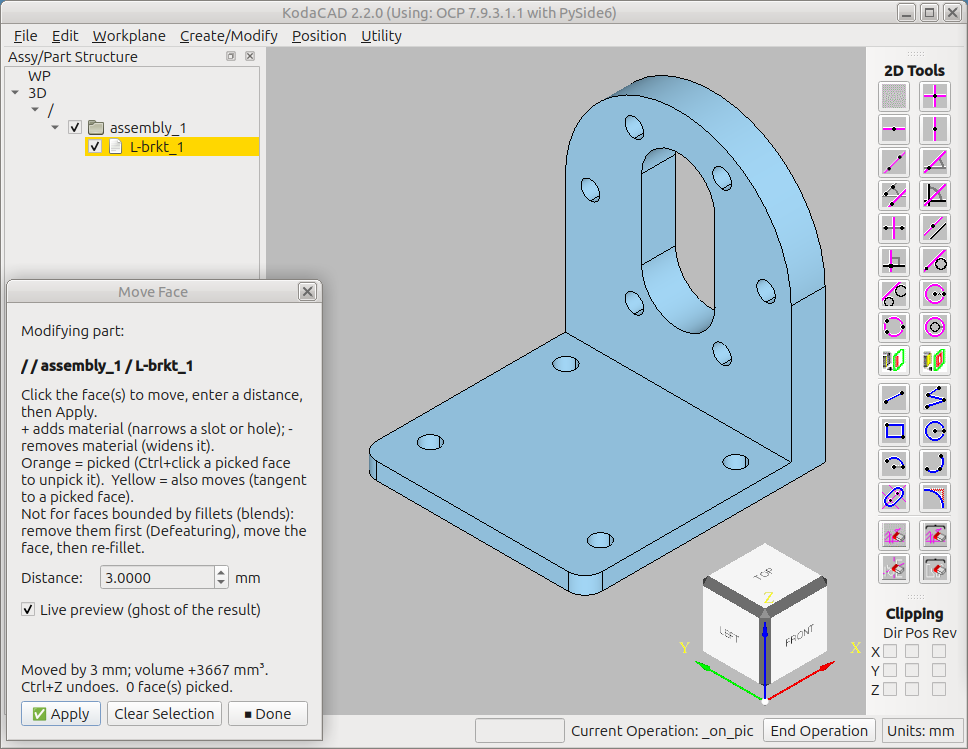

The upright is 3 mm thicker. The base is untouched; the face you pushed
simply stretched into the volume next to it. Use **Ctrl+Z** to take it
back and **Ctrl+Y** to redo it.

*Exercises: picking a face; the live preview; positive distance adds
material; Undo/Redo.*

## Step 3 -- Thicken the base

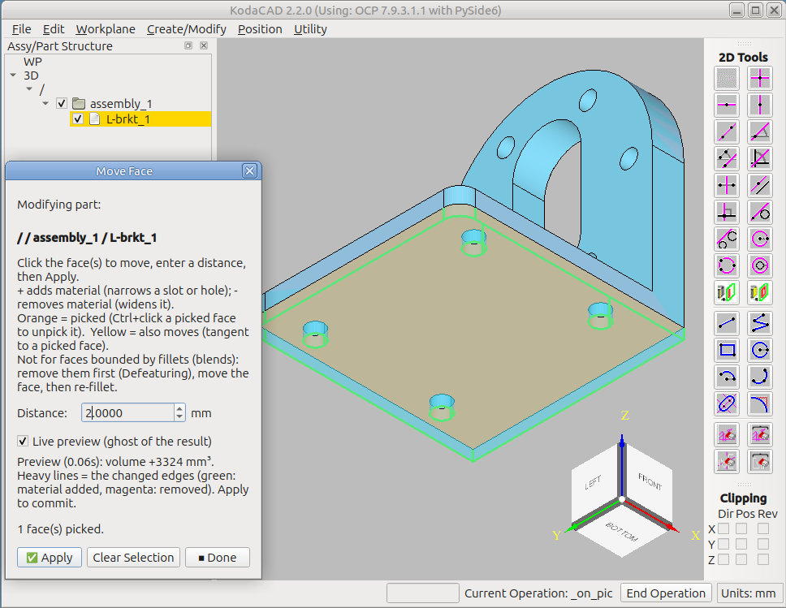

Rotate to look at the **underside** of the base. Click the underside face,
type **2**, and watch the preview: **+3324 mm³**, with green lines around
the new outline and at each of the four holes.

Click **Apply**.

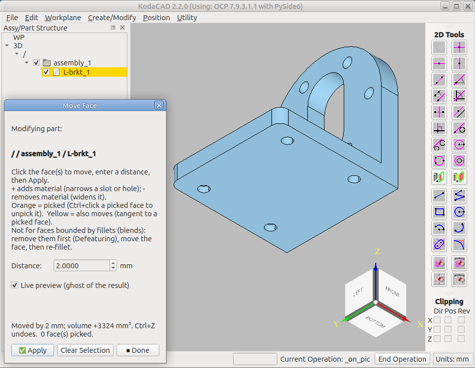

The four holes are now 2 mm longer. You never touched them. When a face
moves, the faces it meets move or stretch with it, and the holes in the
base are just faces that meet the underside.

*Exercises: another face on another part of the model; holes following
the face they pass through.*

## Step 4 -- Widen the slot (and what to do when Move Face says no)

Now the long slot. Rotate back to the view of the slot, click one of its
two flat walls (**orange**) and type **-0.5**. A negative distance removes
material, so the slot gets wider.

The round ends of the slot turn **yellow**: they meet the wall
tangentially, so they move with it, and the whole slot opens up evenly
(**3 more face(s) will move with them**).

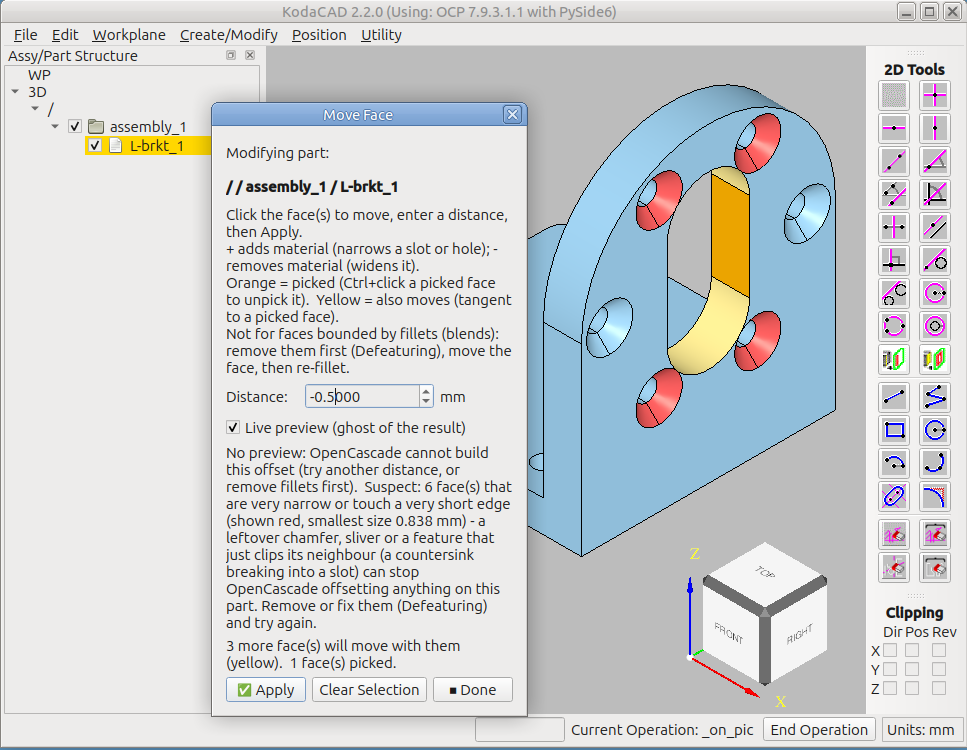

But this time there is **no ghost**. The dialog says *No preview:
OpenCascade cannot build this offset*, and it marks six faces **red**, with
this advice: *a leftover chamfer, sliver or a feature that just clips its
neighbour (a countersink breaking into a slot) can stop OpenCascade
offsetting anything on this part*.

Read the red faces. Four of them are the countersinks around the ends of
the slot. They cut very slightly into the slot, so slightly that the
feature is almost an accident of the original design. OpenCascade's
offset analyses the **whole part** at once, and a feature like this can
make it give up on any face you pick, even one far from the problem.
The dialog cannot fix the part for you, but it tells you where to look.

Fix it with **Defeaturing**, the tool from the previous tutorial:

* Open **Create/Modify -> Defeaturing...** (Move Face can stay open),
  choose **Method: Manual (pick every face)**, and pick the four red
  countersink faces.

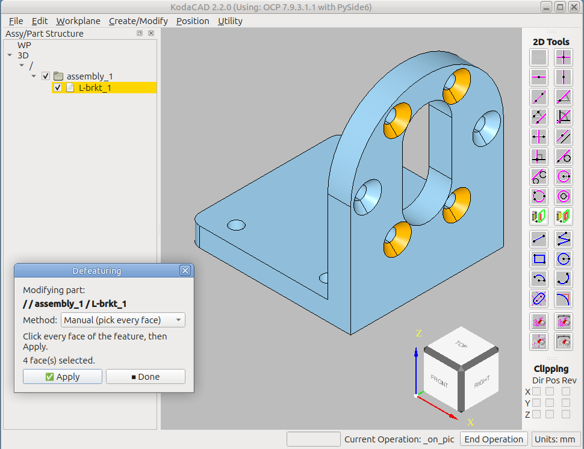

* Click **Apply**, then **Done** to close Defeaturing.

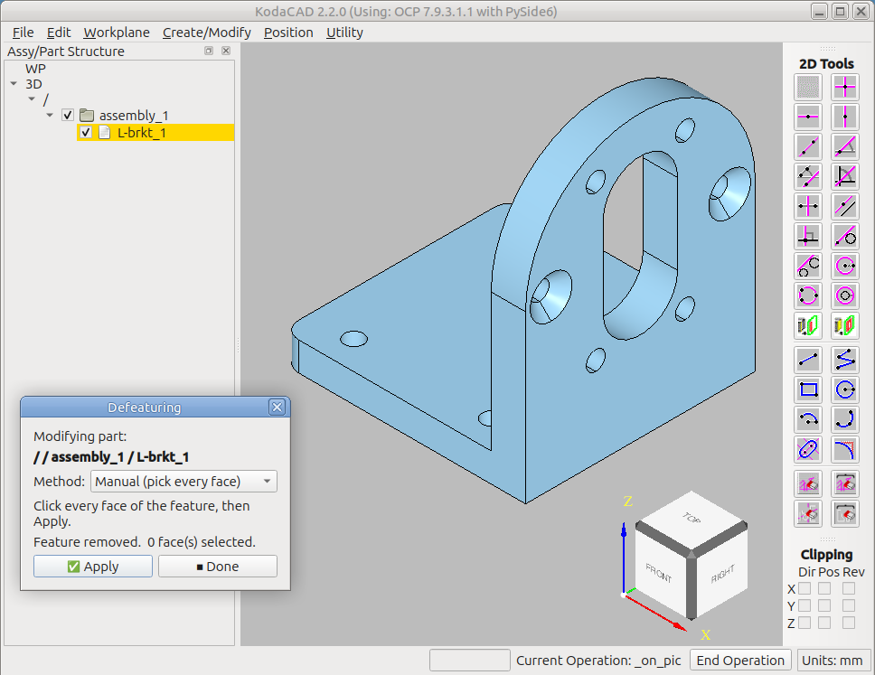

Back in the Move Face dialog, click **Clear Selection** so it starts
fresh on the changed part, pick the slot wall again, and type **-0.5**.
This time the ghost appears. (If you had closed Move Face with **Done**,
just reopen it from **Create/Modify -> Move Face...**.)

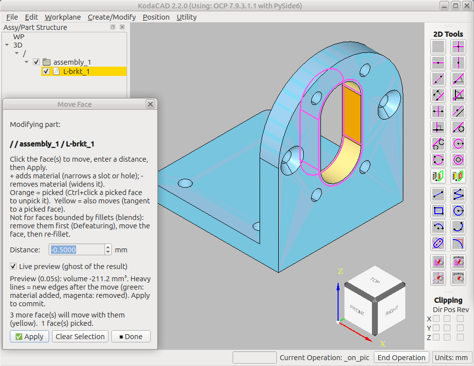

The **magenta** lines outline the new slot, on the front face and where
the walls will end up, and the volume is **-211 mm³**. Click **Apply**.

A slot can also be made *narrower*. Type **1** instead of **-0.5**:

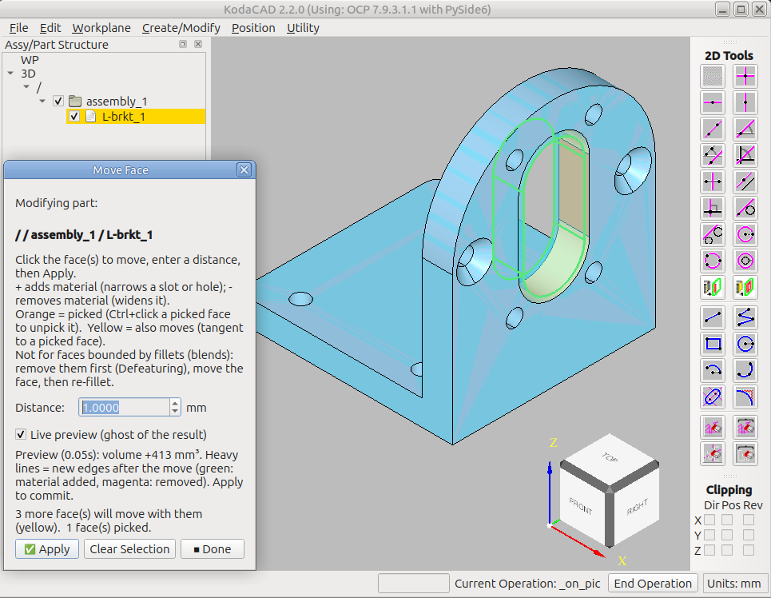

The lines turn **green** (material is added), and the volume reads
**+413 mm³**.

*Exercises: negative distance; yellow tangent faces; reading the red
suspect faces; fixing the part with Defeaturing, then trying again.*

## Step 5 -- Moving several faces at once

Rotate to look straight down on the base. We will open up its four
mounting holes by 0.35 mm, for a clearance fit.

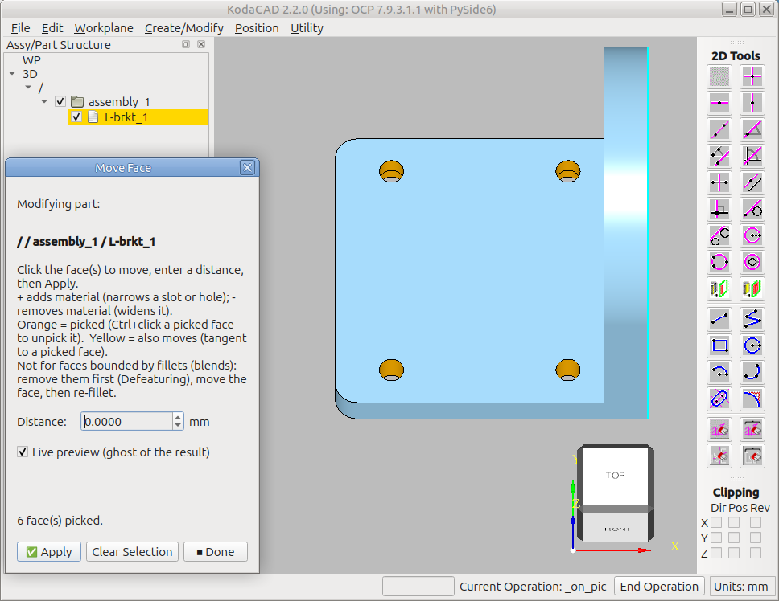

* Drag a **rectangle** around the four holes, **from the top down** (a
  *window* selection: it picks only the faces that lie **entirely**
  inside the rectangle). They turn orange, and the dialog says **6
  face(s) picked**. A drag from the bottom up is a *crossing* selection
  instead, and also picks every face the rectangle merely touches, which
  here would include the base's top face and more.

Six faces for four holes? The dialog counts faces, not holes, and a hole
can be built from more than one face. Two of these holes are made of two
faces each (you can see the circular edge between them if you look
closely).

* Hold **Ctrl** and click one of the holes. It drops out of the selection
  and the count goes down. Ctrl+click on a picked face **unpicks** it.
* Type **-0.35**.

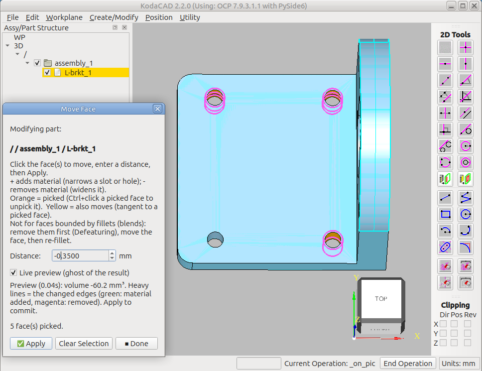

Magenta rings appear in the three holes that will change. The hole you
unpicked is left alone. Click **Apply**.

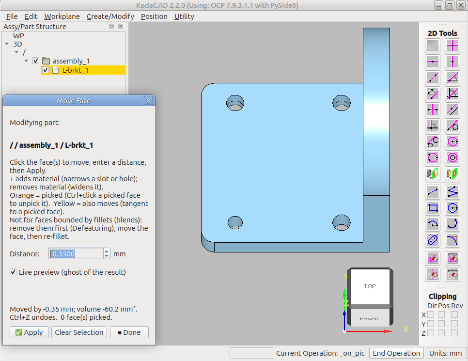

Each picked hole is now 0.7 mm wider in diameter (0.35 mm on each side).

*Exercises: box select; Ctrl+click to unpick; moving several faces with
one distance.*

## Step 6 -- Remove material from a face

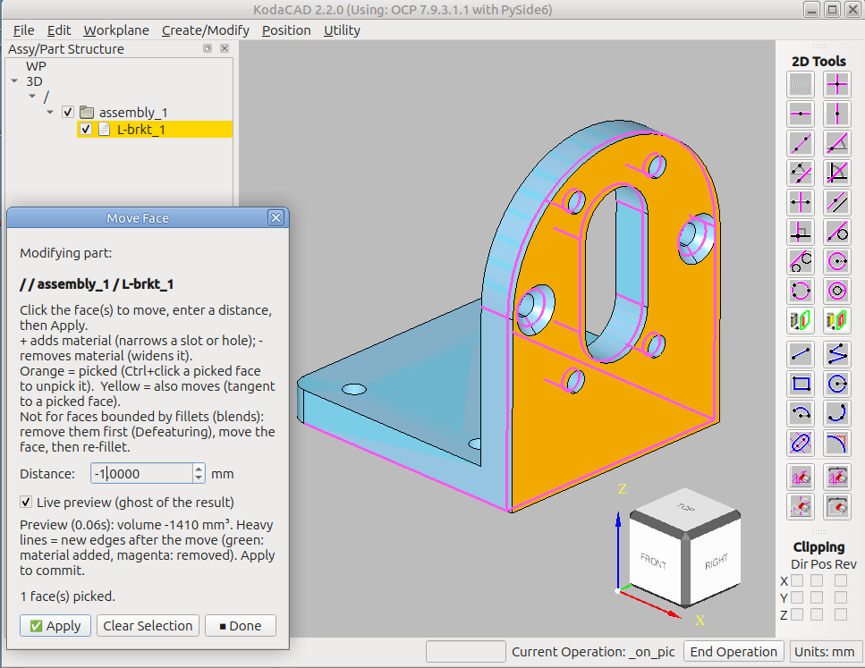

Rotate to the outside of the upright, the face with the six holes and the
slot. Click it and type **-1**. The magenta lines show the new, thinner
outline, and the volume is **-1410 mm³**. Click **Apply**.

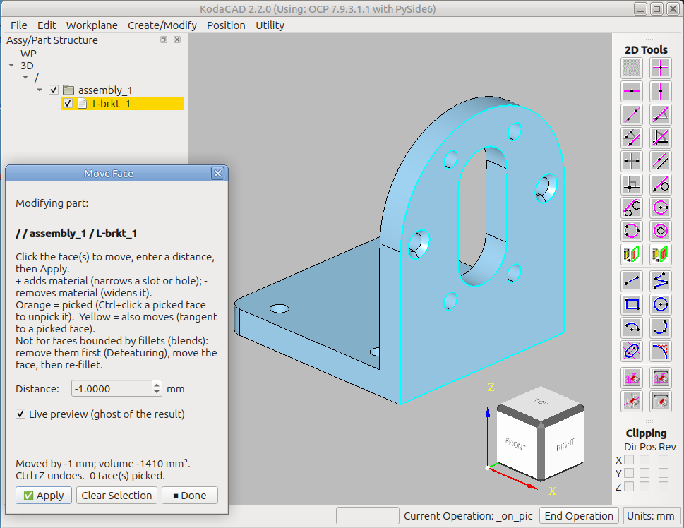

The upright is 1 mm thinner. Any hole through it is 1 mm shorter, and the
slot too. Undo it (Ctrl+Z) if you want the thickness back.

*Exercises: negative distance on a large face; the volume read-out.*

## Step 7 -- A face tangent to others moves its neighbours

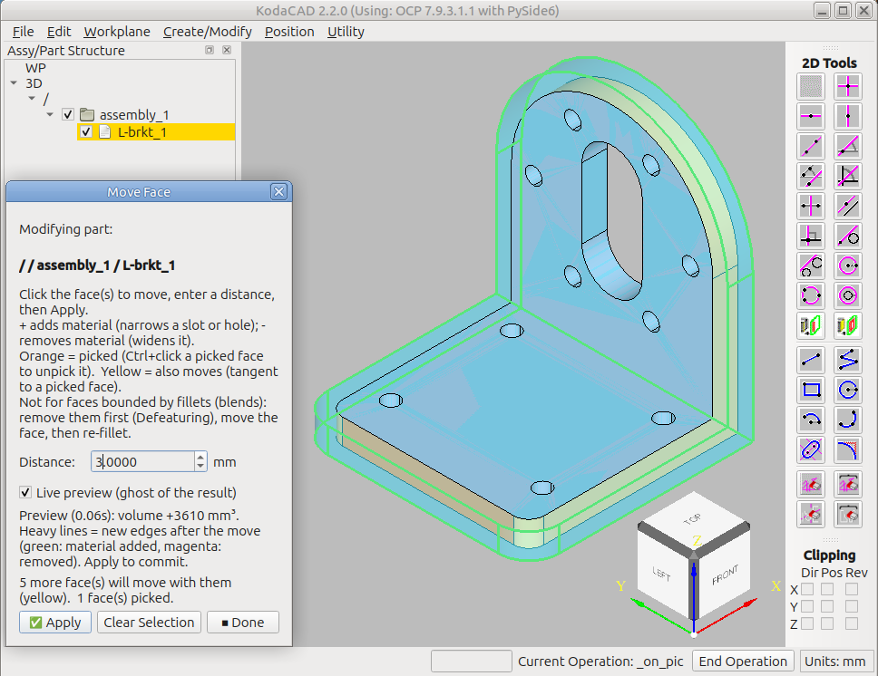

The base has rounded corners, and the end of the upright is round too.
Click the end face of the base and type **3**. This time many faces turn
**yellow**: **5 more face(s) will move with them**. The end face is
tangent to the rounded corners, which are tangent to the side faces and to
the rim of the upright. They are all one smooth skin, and OpenCascade's
offset treats the whole skin as one thing: **move any one face of it and
they all move**.

That is why Move Face shows the yellow faces before you commit. If the
answer is not what you intended, press **Clear Selection**, or Ctrl+click
the face to unpick it, and nothing changes. If you do want a part of a
tangent skin to move by itself, remove the blends first with
**Defeaturing**, move the face, and put the blends back (with Fillet).

Do not Apply here, or undo it.

*Exercises: tangent chains; why yellow faces matter.*

---

## Limits

- **Faces bounded by fillets (blends).** Move Face is not for these: the
  offset has to rebuild the blend, and it often fails. Remove the blends
  first (Defeaturing), move the face, then re-fillet.
- **A failed preview means this offset failed.** The dialog says so and
  marks the suspect faces red. Trying a different distance sometimes
  helps. Removing the red faces usually does.
- **The part must be one solid.** A part with several solids is not
  previewed.

---

## Notes for whoever runs this next

- **Where the work happens.** The ghost is computed in a second
  Python process (`face_offset_server.py`, started with `python -I`), so a
  slow offset never freezes the GUI. The server is restarted if it dies
  or takes longer than 90 seconds. Apply reuses the preview result when it
  can.
- **A fast path for simple moves.** If the picked face is planar and every
  neighbour is a plane parallel to the move direction, or a cylinder whose
  axis is parallel to it (the upright's face, the base underside), the move
  is done by adding or removing a prism of the face, which is exact and
  does not depend on OpenCascade's whole-part offset analysis. The result is only
  accepted if the volume change equals area times distance. Anything
  else, including cones such as countersinks, goes to the offset algorithm.
- **Why one feature far away can block a move.** `BRepOffset_MakeOffset`
  can report success and still return a null shape if something on the part
  confuses it. In this tutorial that something is the sliver-thin
  overlap between the countersinks and the slot. Earlier, on a Geneva wheel, it was
  a 2.7 mm leftover chamfer facet. The dialog's red "suspect" faces find
  faces that are very narrow or touch a very short edge. That is a good
  guide, but not a proof: the red faces are where to start looking.
- **Yellow faces are an estimate.** They are our own tangency test,
  computed from the face normals along each shared edge (a stored
  continuity flag is not trusted, since Defeaturing and some STEP files
  drop it). OpenCascade decides what really moves. If the volume read-out
  or the preview surprises you, believe the preview.
- **The colored lines come from comparing edges.** Edges of the result that
  the part does not have are drawn on top of everything, so a thin change
  inside the solid is visible. Straight edges are trimmed to the stretch
  that changed. A boolean difference of result and original was tried
  first and abandoned: the two shapes share almost every face and the
  boolean returned nonsense.
- **Two box-select modes, told apart vertically.** In KodaCAD a drag from
  top to bottom is a *window* selection (entirely inside the box), and a drag from
  bottom to top is a *crossing* selection (inside or touching the box). This
  is unlike many CAD programs, where it is left-to-right versus
  right-to-left.
- **Box select counts faces.** Two of this bracket's four base holes are
  made of two cylinder faces, so box selecting them reports 6. Moving
  either piece of such a hole drags the other with it (yellow), so the
  result is the same whether you pick one or both.
- If any menu label, dialog control name or message has drifted from what
  is written here, fix it in this document directly. Catching that drift
  is exactly what this tutorial is for.
